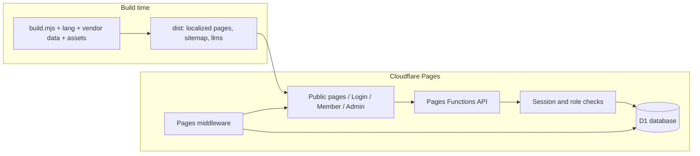
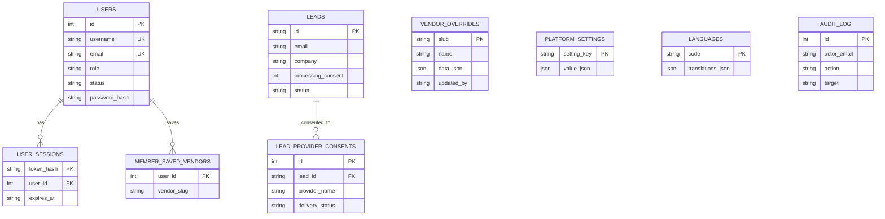

# โครงสร้างระบบ MarTech Discovery Platform

เอกสารอ้างอิงระบบจาก source code ปัจจุบัน ปรับปรุงล่าสุด 26 พฤศจิกายน 2026 ใช้แยกความสามารถที่เชื่อมฐานข้อมูลแล้วออกจากหน้าจอต้นแบบ เพื่อวางงานต่อและสื่อสารกับทีม

## 1. ภาพรวมสถาปัตยกรรม

เว็บมีหน้า public ที่สร้างเป็นไฟล์ HTML ระหว่าง Build และ API ที่ทำงานเป็น Cloudflare Pages Functions ข้อมูลบัญชี Vendor และ Lead ที่รองรับการใช้งานจริงจัดเก็บใน Cloudflare D1



**สรุปเส้นทางข้อมูล:** browser เรียกหน้าเว็บหรือ API → Functions ตรวจ session และ role สำหรับ endpoint ที่ต้องป้องกัน → อ่าน/เขียน D1 → ส่งผลกลับหน้าเว็บ ส่วนการสร้างหน้าสาธารณะและ Sitemap ทำตอน Build แล้ว Deploy ไป Pages

## 2. โครงสร้าง URL และหน้า

### Public pages

```text
/
├── /th/ และ /en/
├── /{lang}/categories/
│   └── /{lang}/categories/{category-slug}/
├── /{lang}/tools/
├── /{lang}/providers/{vendor-slug}/
├── /{lang}/buyer-guide/
│   └── /{lang}/buyer-guide/preview/
├── /{lang}/for-buyers/
├── /{lang}/for-providers/
└── /{lang}/editorial-policy/
```

### Account and Backoffice pages

```text
/{lang}/login/
/{lang}/change-password/
/{lang}/member/
/admin/
```

เส้นทางบัญชีและ Admin ไม่รวมใน Sitemap สาธารณะ หน้า `/admin/` เป็น shell เดียว แล้วเปลี่ยนเนื้อหาตามเมนูโดย JavaScript

## 3. เมนู Admin และระดับการทำงาน

| เมนู | หน้าที่ | สถานะข้อมูล |
|---|---|---|
| Dashboard | ภาพรวมการทำงาน | ตัวเลข/งานบางส่วนเป็นข้อมูลตัวอย่าง |
| Vendors | แก้รายละเอียด ตรวจชื่อ/โลโก้ นำเข้าและส่งออก | เชื่อม D1 ผ่าน `/api/admin/vendors` |
| Deals & Pipeline | จำลองขั้นตอนติดตามดีล | ยังเป็น workflow ต้นแบบ |
| Placements / Sponsor packages | แก้ตัวอย่างแพ็กเกจและพื้นที่ Sponsor | บันทึกใน `localStorage` ของ browser |
| Lead Inbox | ดูคำขอและรายละเอียด consent | อ่าน Lead จาก D1 ได้; มี local demo fallback |
| Members & roles | สร้างผู้ใช้และกำหนดสิทธิ์ | เชื่อม D1; เฉพาะ Super Admin |
| SEO Manager | หน้าจอเครื่องมือ SEO | ยังไม่มี API กลางสำหรับบันทึกการตั้งค่า SEO |
| Sitemap & AI files | เปิด Sitemap/LLM files ดู route registry และ export CSV | ไฟล์สร้างตอน Build; หน้า Admin ใช้ตรวจดู/ส่งออก |
| Data Ontology | ดูแบบจำลองข้อมูลและเพิ่ม field ทดลอง | การแก้ไขบันทึกใน `localStorage` |
| Theme & Languages | ปรับสี/ฟอนต์และจัดการภาษาในหน้า Admin | การตั้งค่าเก็บใน `localStorage`; ยังไม่เปลี่ยนค่า production ให้ทุกคน |

## 4. สิทธิ์บัญชีและการยืนยันตัวตน

- **Member:** ดูพื้นที่สมาชิกและเก็บรายการ Vendor ที่สนใจ
- **Admin:** จัดการ Vendor และดู Lead
- **Super Admin:** ทำงานระดับ Admin ได้ และสร้างบัญชี/เปลี่ยน role หรือสถานะผู้ใช้

การเข้าสู่ระบบตรวจ username/password ผ่าน `/api/auth/login` รหัสผ่านถูกแฮชด้วย PBKDF2 และ salt ก่อนจัดเก็บใน D1 ส่วน browser ได้ session cookie ที่ตั้ง `HttpOnly`, `Secure`, `SameSite=Lax`; API ใช้ `requireRole()` ปฏิเสธผู้ใช้ที่ไม่มีสิทธิ์ บัญชีที่สร้างจาก Admin ได้ temporary password และบังคับเปลี่ยนรหัสผ่านครั้งแรก

## 5. API และการเชื่อมต่อ

| Endpoint | หน้าที่ | การควบคุม |
|---|---|---|
| `/api/auth/login` | เข้าสู่ระบบ | ตรวจบัญชี/รหัสผ่านและออก session |
| `/api/auth/logout` | ออกจากระบบ | ยกเลิก session |
| `/api/auth/password` | เปลี่ยนรหัสผ่าน | ต้องมี session |
| `/api/member/me` | อ่านบัญชีปัจจุบัน | ต้องมี session |
| `/api/member/favorites` | อ่าน/เพิ่ม/ลบ Vendor ที่บันทึก | Member หรือ Admin |
| `/api/admin/users` | อ่าน/สร้าง/ปรับ role และสถานะผู้ใช้ | Super Admin เท่านั้น |
| `/api/admin/vendors` | อ่าน/แก้/นำเข้า/ทบทวน Vendor | Admin หรือ Super Admin; การเขียนตรวจ same-origin |
| `/api/leads` | รับ Lead, อ่าน Lead, ลบแบบ soft-delete | POST public พร้อม consent; GET/DELETE สำหรับ Admin |
| `/api/vendors/{slug}` | อ่านโปรไฟล์สาธารณะ | ส่งคืนเฉพาะ Vendor สถานะ Published |

`functions/_middleware.js` อ่านข้อมูล Vendor ที่เผยแพร่จาก D1 แล้วปรับ title, description และข้อมูลโปรไฟล์บน HTML route ที่ Build สร้างไว้

## 6. โครงสร้าง D1



Migration เริ่มต้นอยู่ที่ `migrations/0001_initial.sql` มี `auth_rate_limits` และ `lead_rate_limits` สำหรับจำกัดการลองรหัสผ่าน/ส่ง Lead ด้วย

`audit_log.actor_email` เก็บผู้กระทำในรูปข้อความ ยังไม่ได้ผูก foreign key กับ `users` ส่วน `member_saved_vendors.vendor_slug` ก็เก็บ slug เป็นข้อความ ไม่ได้บังคับ foreign key กับ Vendor record

## 7. Sitemap และไฟล์ค้นพบข้อมูล

`build.mjs` สร้าง route จากภาษาใน `lang/*.json`, หมวดหมู่และรายการ Vendor ที่ใช้ Build แล้วสร้าง:

- `sitemap.xml` — XML URL set พร้อม `changefreq`, `priority` และ alternate `hreflang`
- `sitemap.xsl` — รูปแบบอ่านง่ายใน browser ไม่เปลี่ยนตัว XML ที่ crawler อ่าน
- `robots.txt` — อ้าง Sitemap และไม่เปิด `/admin/` ให้ crawler
- `llms.txt` และ `llms-full.txt` — ดัชนีหน้าและข้อมูลสำหรับระบบ AI
- `route-registry.js` — รายการ public routes ที่หน้า Admin ใช้แสดง/ส่งออก

Sitemap เป็น **build-time artifact** ไม่ได้อ่าน URL จาก D1 ตอน request หากเพิ่มภาษา/หมวด/โปรไฟล์ในข้อมูลต้นทาง ต้อง Build และ Deploy ใหม่ โปรไฟล์ Vendor ที่เพิ่มเฉพาะใน D1 ยังไม่สร้าง route ใหม่ในรายการ Build โดยอัตโนมัติ

## 8. ข้อมูลที่บันทึกจริงกับส่วนต้นแบบ

### บันทึกใน D1

- บัญชี, role, session และสถานะผู้ใช้
- ข้อมูล Vendor overrides และ audit บาง action
- Lead, consent ของผู้ให้บริการที่ระบุชื่อ และสถานะ Lead
- Vendor favorites ของสมาชิก

### ยังเป็น local/demo หรือ build-time

- สี/ฟอนต์/ภาษา/ontology ในหน้า Admin: `localStorage` ของ browser เครื่องนั้น
- Sponsor packages, Deals และ Placements: workflow ต้นแบบ/local demo
- Sitemap และ LLM files: สร้างจาก source ตอน Build; Admin ใช้เปิดดูและ export route list
- Lead delivery: เก็บ consent และสถานะใน D1 ได้ แต่ยังไม่เชื่อมส่งเข้า CRM/email ของ Sponsor อัตโนมัติ

## 9. แผนผังไฟล์หลัก

```text
build.mjs                 สร้างหน้าและ SEO files
lang/                     locale dictionaries
functions/
  _middleware.js          ปรับ SEO/profile จาก D1 ใน public profile routes
  _shared/auth.js         session, password hash และ role checks
  api/                    endpoints บัญชี Vendor Lead และ Member
migrations/               D1 schema
assets/                   ฟอนต์ โลโก้ และ artwork
admin.html                shell ของ Backoffice
admin.js                  เมนูและหน้า Admin หลัก
admin-workflows.js        users, leads, sponsor demo, vendor import/export
admin-config.js           หน้าตั้งค่า/ontology ที่เก็บ localStorage
vendor-categories.json    ข้อมูลหมวดหมู่ Vendor
vendor-logos.json         mapping โลโก้ Vendor
vendors.txt               รายชื่อ Vendor ที่ใช้ตอน Build
dist/                     output ที่สร้างใหม่; ไม่ใช่ source of truth
```

## 10. ขอบเขตและงานที่ต้องต่อ

1. ทำ API สำหรับบันทึก `platform_settings`, `languages` และ ontology draft ลง D1 แล้วให้หน้าเว็บอ่านค่ากลาง
2. ทำข้อมูล Sponsor packages, Deals และ Placements ให้มี schema/API และ audit trail
3. ออกแบบการส่ง Lead ให้ Sponsor ตาม consent พร้อมบันทึก delivery status และเชื่อม CRM/email ที่เลือก
4. เชื่อม Vendor ที่เผยแพร่ใน D1 เข้ากับการสร้าง public routes, Sitemap และ language alternates อัตโนมัติ
5. แยกข้อมูลตัวอย่างออกจาก production data อย่างชัดเจนในแต่ละ workflow

## 11. จุดเริ่มต้นสำหรับแก้ระบบ

- แก้ URL/page generation: `build.mjs`
- เพิ่ม/แก้ภาษา: `lang/` และ logic ใน `build.mjs`
- เพิ่ม D1 table: สร้าง migration ใหม่ใน `migrations/`
- เพิ่ม API: เพิ่ม route ใต้ `functions/api/` พร้อม role/origin checks
- แก้หน้า Admin: `admin.html`, `admin.js`, `admin-workflows.js`, `admin-config.js`, `admin.css`
- เปลี่ยน deployment configuration: `wrangler.jsonc`
